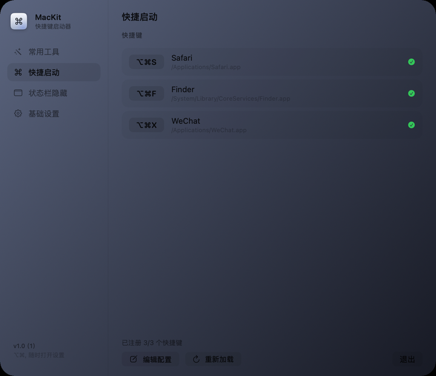
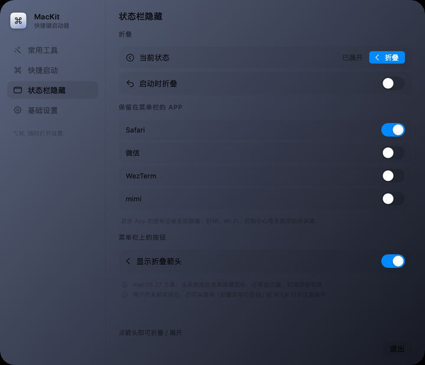
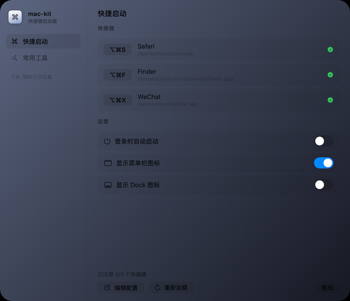
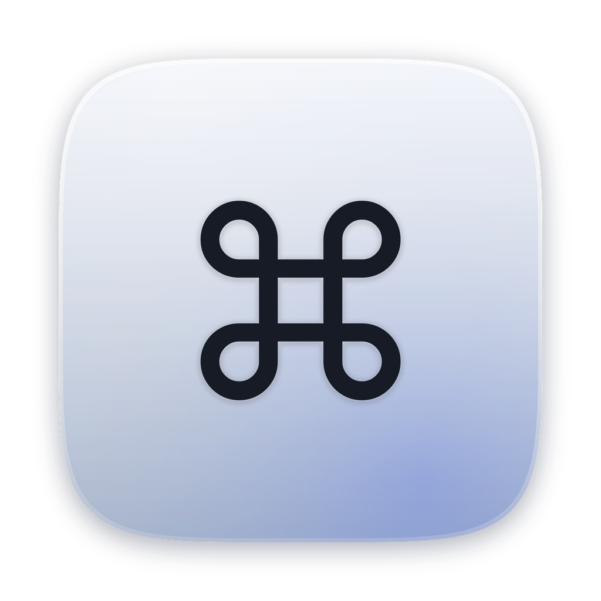
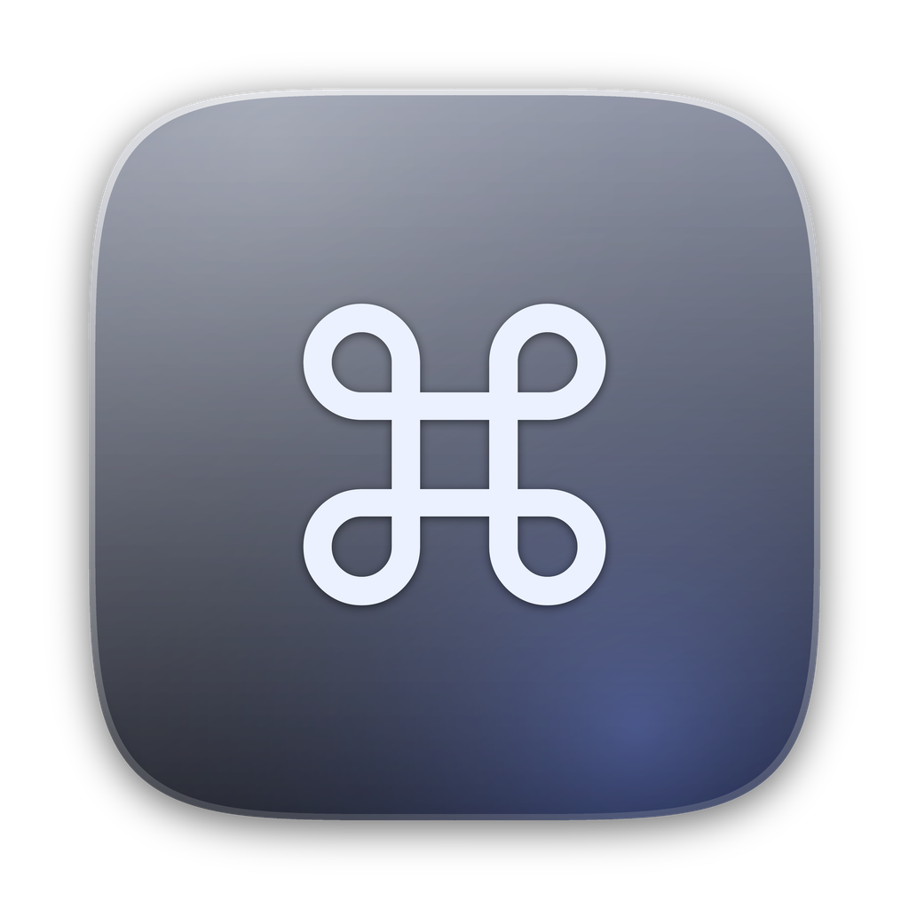

# MacKit

一个 macOS 菜单栏小工具：**用全局快捷键打开（或切换到）不同的 App**。

- 纯 Swift + AppKit / SwiftUI，编译产物约 200 KB
- 常驻菜单栏，平时不占 Dock（`LSUIElement`）；打开设置窗口时临时显示 Dock 图标
- 用 Carbon `RegisterEventHotKey` 注册全局热键，**不需要辅助功能（Accessibility）权限**
- 设置窗口左侧是侧栏，四页：**常用工具**（清空记录）、**快捷启动**（全局快捷键）、**状态栏隐藏**（折叠菜单栏图标）、**基础设置**（App 自身开关），可拖动排序
- 常用工具：清空 Safari 浏览记录（按今天 / 今天和昨天 / 一周 / 一个月 / 全部）、最近使用文件记录，可分别勾选
- 开机自启时只驻留菜单栏；**手动打开（Finder 双击 / Dock / `open`）会直接弹出设置窗口**
- 默认注册 **⌘⌥K** 直接打开设置窗口，可在设置里关掉
- 菜单栏图标折叠（类似 Hidden Bar）：分隔线左侧的图标可一键收进屏幕外，可设为启动时自动折叠
- 自动检查更新：每 6 小时查一次 GitHub Release，发现新版本在设置页和菜单栏提示，点一下开下载页
- 图标与设置窗口都按 macOS 26/27 的 Liquid Glass 风格重新设计
- 配置是一个 JSON 文件，改完点「重新加载配置」即生效

| 常用工具 | 快捷启动 | 状态栏隐藏 | 基础设置 |
|---|---|---|---|
|  |  |  |  |

## 图标

图标按 macOS 图标网格绘制：1024 画布、内容区 824、超椭圆（n=5）连续圆角，4 倍超采样后降采样。玻璃层次为：投影 → 底色渐变 → 色晕 → 斜向反光 → 边缘亮环 → 底部厚度 → ⌘ 字形。

| 亮色 | 暗色 |
|---|---|
|  |  |

**自动切换**：启动时和系统外观变化时（KVO `NSApp.effectiveAppearance` + `AppleInterfaceThemeChangedNotification`）切换 `NSApp.applicationIconImage`。设置窗口顶部的图标也会跟着变。

> 限制：`.icns` 格式本身不支持「同一图标多外观」，macOS 26 的图标外观变体（亮/暗/着色）要走 Icon Composer 的 `.icon` + `Assets.car`，而打包 `Assets.car` 需要 Xcode 的 `actool`（本机只装了 Command Line Tools，`actool` 不可用）。所以：
> - 运行中的 App（Dock、⌘-Tab、关于面板、设置窗口）里图标会跟随亮暗切换；
> - Finder / 访达 / Launchpad 里显示的静态图标固定用亮色版。
>
> 等装了 Xcode，用 Icon Composer 打开 `docs/icon-light.png` / `docs/icon-dark.png` 做成 `.icon` 就能做到 Finder 里也自动切换。

## 设置窗口

菜单栏图标 →「偏好设置…」（⌘,），或者直接手动打开 App。窗口分成侧栏和右侧内容两块：

- 侧栏四项可以上下拖动换顺序，顺序记在 `UserDefaults` 里
- 每次打开默认停在**常用工具**页

**快捷启动**：

- 快捷键列表：每条显示按键、目标 App、解析到的真实路径和注册状态（✓ / ⚠）
- 按钮：编辑配置 / 重新加载 / 退出

**基础设置**（App 自身）：

- 登录时自动启动（LaunchAgent）
- 显示菜单栏图标 / 显示 Dock 图标
- ⌘⌥K 打开设置窗口（可关）
- 两个隐藏开关都关掉时，这里会显示橙色兜底提示
- **关于**：当前版本、「检查更新」按钮、自动检查开关；发现新版本时多出一个「下载 vX.Y.Z」按钮

**状态栏隐藏**（两套引擎，按系统自动选）：

- 「当前状态」那一行直接显示已折叠 / 已展开，右边的按钮一键切换
- 「启动时折叠」决定 App 启动时是否自动收起
- **保留在菜单栏的 App**：勾选的 App 保持可见，其余第三方图标由系统隐藏；系统项（时钟、Wi-Fi、控制中心）始终保留
- 「显示折叠箭头」可以关掉菜单栏上的按钮；关掉后仍可从菜单「折叠菜单栏图标」或 ⌘⌥K 打开这一页

### 两套隐藏引擎

| 系统 | 做法 | 说明 |
|---|---|---|
| macOS 27+ | 调用系统可见性白名单 | 菜单栏由 `MenuBarAgent` 托管，`MBAssessmentModeConfiguration` 能按 App 白名单隐藏图标并由系统重排；任意显示器、刘海屏都有效 |
| macOS 26 及更早 | 撑宽分隔条 | 老做法：点箭头把分隔条撑到 10000pt，把左边图标顶出屏幕；⌘ 拖动细线划分区域 |

macOS 27 上隐藏是**按 App 生效**的：一个 App 有多个图标会一起隐藏；判断依据是 `keepBundleIDs` 白名单（`UserDefaults`）。

> 注意：27 的白名单接口来自私有框架 `MenuBarClientCore.framework`（运行时 `dlopen`，找不到就自动回落旧引擎），系统更新可能改变它；隐藏期间退出 App 会自动解除限制。

### 检查更新

- 启动 8 秒后查一次（距上次检查超过 6 小时才查），之后每 6 小时一次；可在设置里关掉自动检查
- 数据来源是 GitHub：先读 `releases/latest`，仓库还没有 Release 时退回读 `tags`；两者都没有就显示「仓库还没有发布版本」
- 版本号按段比数字（`v1.2.0` > `1.0`），直接开 Release 页面下载，不做静默替换
- 菜单栏也有「检查更新…」，有新版本时会多一条「有新版本 vX.Y.Z…」

**常用工具**（默认页）：

- Safari 浏览记录、最近使用文件记录两个开关，决定「一键清空记录」清哪些
- Safari 那一行带范围选择：**今天**（今天 0 点起）、**今天和昨天**、**一周**（7 天前 0 点起）、**一个月**、**全部**
- 按范围清历史是打开 `History.db` 用 sqlite3 删 `history_visits` 里 `visit_time` 落在范围内的行，再把因此变空的 `history_items` 清掉；选「全部」则直接删库文件
- 一键清空记录：二次确认后执行，结果显示在页面上
- 两个目录都受 TCC 保护，需要在「系统设置 → 隐私与安全性 → 完全磁盘访问权限」里勾选 MacKit；页面里有直接跳转该设置的按钮
- 清 Safari 历史时如果 Safari 正在运行，会弹框问「退出 Safari 并清空」还是取消；确认后先让 Safari 优雅退出再清

### 隐藏菜单栏图标 / 隐藏 Dock 图标

两个开关存在 `UserDefaults`（域 `com.kaix.mac-kit`），改完立即生效并持久化：

- **显示菜单栏图标**（默认开）：关掉后 `NSStatusItem.isVisible = false`，菜单栏图标消失
- **显示 Dock 图标**（默认关）：开 = `NSApp.setActivationPolicy(.regular)`（Dock + ⌘-Tab 可见），关 = `.accessory`（只在菜单栏）

**安全兜底**：两个都关掉时 App 会完全不可见，所以在设置窗口里会显示橙色提示，并且始终注册了一个固定热键 **⌥⌘,** 用来打开设置窗口——不依赖任何配置文件，也不会被隐藏开关影响。

窗口背景在 macOS 26+ 用 `NSGlassEffectView`（27 上额外开启 `effectIsInteractive`），更老的系统回退到 `NSVisualEffectView` 的 `.hudWindow` 毛玻璃。

## 默认快捷键

装好后自动生成配置，只包含系统里真实存在的 App：

| 快捷键 | 打开 |
|---|---|
| ⌥⌘S | Safari |
| ⌥⌘F | Finder |
| ⌥⌘X | 微信 |

三个应用都用到时才写入配置（找不到的 App 会被跳过）；想加更多 App，直接往 `config.json` 的 `hotkeys` 数组里加一条，再点「重新加载」。

> 组合被系统或别的 App 占用（比如和 Loop 的触发键撞了）时注册会失败，设置窗口里显示 ⚠，日志里写明原因。

## 配置文件

路径：`~/Library/Application Support/mac-kit/config.json`

```json
{
  "hotkeys": [
    { "key": "1", "modifiers": ["option", "command"], "target": "Finder" },
    { "key": "k", "modifiers": ["option", "command"], "target": "kitty" },
    { "key": "s", "modifiers": ["control", "option"], "target": "com.apple.Safari" },
    { "key": "v", "modifiers": ["option"], "target": "/Applications/Visual Studio Code.app" }
  ]
}
```

**字段**

- `key`：键名，见下
- `modifiers`：`command`(⌘) / `option`(⌥) / `control`(⌃) / `shift`(⇧)，也接受 `cmd` `alt` `opt` `ctrl` 和 `⌘⌥⌃⇧`
- `target`：应用名（`kitty`）、Bundle ID（`com.apple.Safari`）或完整路径

**支持的键名**：`a`–`z`、`0`–`9`、`f1`–`f12`、`space`、`tab`、`return`、`escape`、`delete`、`home`、`end`、`pageup`、`pagedown`、方向键、`minus`、`equal`、`leftbracket`、`rightbracket`、`semicolon`、`quote`、`comma`、`period`、`slash`、`backslash`、`grave`

## 命令行

```bash
APP=/Applications/MacKit.app/Contents/MacOS/MacKit

$APP --check                 # 检查每个快捷键能否注册、目标能否解析、当前图标选型
$APP --open Finder           # 单独测试某个 target 能否被打开
$APP --settings              # 启动并直接打开设置窗口
$APP --tools-check           # 只读检查清理目标（列出文件、报告是否有完全磁盘访问权限）
$APP --range-test            # 用临时库验证各时间范围的删除结果（不动真实历史）
$APP --version               # 打印当前版本
$APP --update-check          # 立刻查一次更新（顺带打印版本比较自检）
$APP --update-fixture        # 用一段示例 Release JSON 验证解析与版本比较
$APP --visibility-test       # 隐藏其它菜单栏图标 12 秒后自动恢复（验证 27 的白名单接口）
$APP --login-status          # 查看是否已装开机自启
$APP --login-on/--login-off  # 安装 / 移除开机自启（LaunchAgent）
$APP --snapshot out.png      # 离屏渲染设置界面（检查排版），--page tools|launcher|settings 选页
```

`--check` 输出示例：

```
✓ ⌥⌘3 → kitty  (/Applications/kitty.app)
当前外观: dark，图标: 已加载（AppIcon-Dark.icns）
6/6 个快捷键可用
```

`--tools-check` 不会删除任何文件，只告诉你目标路径是否可访问、有哪些文件会被清理：

```
Safari 运行中: 否
Safari 记录目录: 可访问
  存在  History.db
  不存在  History.db-wal
最近使用目录: /Users/kaix/Library/Application Support/com.apple.sharedfilelist
  待清理 12 项
```

## 日志

`~/Library/Logs/mac-kit.log`：启动、快捷键注册、打开结果、图标加载。

## 构建

```bash
cd mac-kit   # 仓库目录名仍是 mac-kit
./build.sh              # 构建并安装到 /Applications
./build.sh none         # 只构建
```

重新构建前先退出旧实例：

```bash
pkill -f 'MacOS/MacKit'
```

## 重新生成图标

```bash
# 需要带 Pillow 的 python3
python3 tools/make_icon.py

# 生成 iconset → icns（build.sh 只复制 Resources/ 里的 icns，不会自动跑这两步）
for v in Light Dark; do
  # 见 README 历史或 docs/；手工按 16/32/64/128/256/512/1024 生成 iconset 后：
  iconutil -c icns build/$v.iconset -o Resources/AppIcon-$v.icns
done
```

## 卸载

```bash
pkill -f 'MacOS/MacKit'
/Applications/MacKit.app/Contents/MacOS/MacKit --login-off   # 先卸掉开机自启
rm -rf /Applications/MacKit.app
rm -rf ~/Library/Application\ Support/mac-kit
rm -f ~/Library/Logs/mac-kit.log
```

开过「登录时自动启动」的话，先在设置窗口里关掉再删。若在系统设置里给过完全磁盘访问权限，记得一并取消。

## 发布新版本

App 内检查的是 GitHub 上的 Release，所以发版要做两件事：

1. 把 `Info.plist` 的 `CFBundleShortVersionString` 改成新版本号（`CFBundleVersion` 递增）
2. 在 GitHub 上打 tag `vX.Y.Z` 并建一个 Release（附件可选，检查更新只读 tag 和 release 页面）

没有 Release 时检查更新会显示「仓库还没有发布版本」，不会误报。

## 实现要点

- `AppDelegate` 安装 `NSStatusItem` 和 Carbon 事件处理器；热键回调通过 `GetEventParameter(typeEventHotKeyID)` 拿到 id 查表
- `RegisterEventHotKey` 返回的 `EventHotKeyRef` 都存着，重载配置时先 `UnregisterEventHotKey`
- 打开用 `NSWorkspace.openApplication(at:configuration:)`，已运行则激活
- 设置窗口是 `NSHostingView(SwiftUI)` 套在 `NSGlassEffectView` 里，窗口 `titlebarAppearsTransparent` + `fullSizeContentView`
- 侧栏选中项、清空确认弹窗都存在 `MacKitModel`（`@Published`）里，没有用 `@State`——纯 Command Line Tools 环境没有 SwiftUI 宏插件，`@State` 编译不过
- 菜单栏图标与 Dock 图标分别由 `NSStatusItem.isVisible` 和 `NSApp.setActivationPolicy(_:)` 控制，状态存 `UserDefaults`
- 更新检查用 `URLSession` 直连 GitHub API，未认证调用（限流 60 次/小时）；拿到 tag 后只比较版本号，更新交给用户在浏览器完成，不做自替换
- 两个保留热键用 Carbon 单独注册：`⌥⌘,`（兜底开设置）和 `⌘⌥K`（开设置，可在设置里关）；`⌘⌥K` 被别的 App 占用时开关会回退并提示
- 开机自启用自己写的 LaunchAgent（`~/Library/LaunchAgents/com.kaix.mac-kit.plist`，`RunAtLoad` + `--login` 参数），不用 `SMAppService`：登录时靠这个参数判断「不是用户手动打开的」，就不弹设置窗口；再次启动已在运行的实例走 `applicationShouldHandleReopen`
- 记录清理只看两处：`~/Library/Safari/History.db*` 和 `~/Library/Application Support/com.apple.sharedfilelist/` 下的 `RecentDocuments` / `RecentApplications` / 各 App 的 `.sfl3`；TCC 拦截时目录本身读不到，据此判定需要完全磁盘访问权限
- 保留热键 `⌥⌘,`（Carbon 注册，id `0xF000`）用于兜底打开设置窗口
