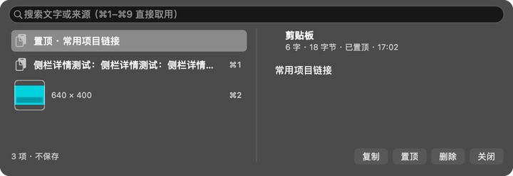
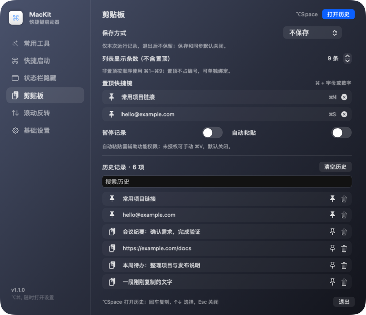
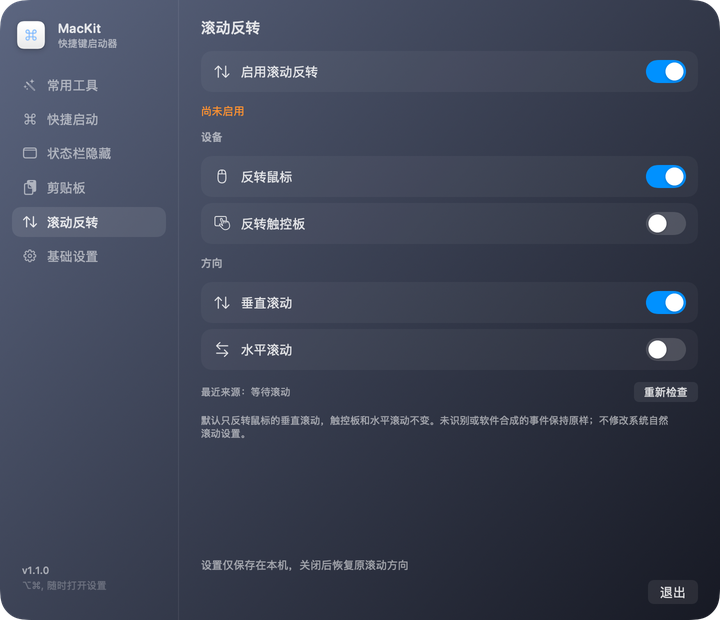

# MacKit

一个 macOS 菜单栏小工具：**用全局快捷键打开（或切换到）不同的 App**。

- 纯 Swift + AppKit / SwiftUI，无第三方运行时依赖
- 常驻菜单栏，平时不占 Dock（`LSUIElement`）；打开设置窗口时临时显示 Dock 图标
- 用 Carbon `RegisterEventHotKey` 注册全局热键，打开窗口和复制历史**不需要辅助功能权限**；可选自动粘贴需要该权限
- 设置窗口左侧是侧栏，六页：**常用工具**（清空记录）、**快捷启动**（全局快捷键）、**状态栏隐藏**（折叠菜单栏图标）、**剪贴板**（历史与保存方式）、**滚动反转**（设备与方向）、**基础设置**（App 自身开关），可拖动排序
- 常用工具：清空 Safari 浏览记录（按今天 / 今天和昨天 / 一周 / 一个月 / 全部）、最近使用文件记录，可分别勾选
- 开机自启时只驻留菜单栏；**手动打开（Finder 双击 / Dock / `open`）会直接弹出设置窗口**
- 默认注册 **⌘⌥K** 直接打开设置窗口，可在设置里关掉
- 菜单栏图标折叠（类似 Hidden Bar）：分隔线左侧的图标可一键收进屏幕外，可设为启动时自动折叠
- 常用工具里可以一键关闭所有普通前台 App，并支持白名单豁免
- iCloud 同步：用 iCloud Drive 里的普通文件夹，在 Mac 之间同步快捷键、侧栏顺序和关闭白名单；菜单栏 / Dock 图标等本机偏好不参与同步
- 自动检查更新：每 6 小时查一次 GitHub Release，发现新版本在基础设置页提示，点一下开下载页
- 图标使用 macOS 27 原生分层资源：亮色白底、暗色近黑底，蓝色 ⌘ 带高光与投影；设置窗口保留 Liquid Glass 风格
- 剪贴板历史：**⌥Space** 打开毛玻璃浮层，左侧紧凑列表、选中后展开右侧详情；非置顶前 9 条使用 **⌘1–⌘9**，置顶在设置页绑定 **⌘ + 字母/数字**；持久保存与同步默认关闭
- 滚动反转：默认仅反转鼠标垂直滚动，触控板不变；支持鼠标、触控板与水平/垂直分别控制，需辅助功能权限
- 配置是一个 JSON 文件，改完点「重新加载配置」即生效

| 常用工具 | 快捷启动 | 状态栏隐藏 | 基础设置 |
|---|---|---|---|
|  |  |  |  |

剪贴板浮层与设置页（均为模拟内容，不包含个人历史）：





## 下载 1.1.0

到 [GitHub Releases](https://github.com/Visero/mac-kit/releases) 下载 `MacKit-1.1.0-macOS-arm64.zip`，解压后把 `MacKit.app` 放入 `/Applications`。本次二进制为 Apple Silicon（arm64），要求 macOS 13 或更高；Intel Mac 可从源码本机构建，未提供或测试 Intel 二进制。

发布包使用本地自签证书，不是 Developer ID 公证包。首次启动可能被 Gatekeeper 提示，请通过系统的「隐私与安全性 → 仍要打开」确认来源；不需要关闭系统安全保护。更新前先退出旧实例，个人配置和剪贴板存储不在应用包内，替换应用不会主动删除它们。

## 1.1.0 更新

- 紧凑毛玻璃剪贴板浮层：640pt 等宽双栏、默认收起详情、图片缩略图、自适应高度。
- 置顶独立快捷键，非置顶按 ⌘1–⌘9 编号，可配置显示条数。
- 操作按钮仅选中后显示，沿用底部计数空间；设置页全页单层滚动。
- 默认八条启动快捷键和内置 JSON 批量编辑器。
- 鼠标/触控板与双轴滚动反转、本机设置持久化及冲突检测。
- 清理重复图标产物、废弃生成逻辑和过期截图，公开截图均使用示例内容。

## 图标

图标用 Apple 官方 Icon Composer 的分层格式制作，源文件在 `Resources/MacKit.icon`：一个透明 ⌘ 图层，Automatic 背景，中性投影（opacity 0.3）和 `specular` 高光。系统在亮色外观下渲染为白底蓝色 ⌘，在暗色外观下渲染为近黑底蓝色 ⌘，边缘和字形带轻微高光。

| 亮色 | 暗色 |
|---|---|
|  |  |

**自动切换**：`Resources/Assets.car` 由 Xcode `actool` 编译，包含 `NSAppearanceNameAqua` / `NSAppearanceNameDarkAqua` 两套原生图标栈；`Info.plist` 的 `CFBundleIconName=MacKit` 让 Finder、Dock、⌘-Tab 直接按系统外观取图。macOS 26+ 不再用运行时位图覆盖系统图标。旧版 macOS 用同一组官方渲染图导出的 `MacKit.icns`；1024 画布内图标表面占 824px、四边各留 100px 透明边距，避免图标被放大。

## 设置窗口

菜单栏图标 →「偏好设置…」（⌘,），或者直接手动打开 App。窗口分成侧栏和右侧内容两块：

- 侧栏六项可以上下拖动换顺序，顺序记在 `UserDefaults` 里
- 每次打开默认停在**常用工具**页
- 状态栏菜单只保留「偏好设置…」和「退出 MacKit」，不再重复列出快捷键、配置、更新、开机自启或折叠设置

**常用工具**：

- 清理 Safari 浏览记录、最近使用文件记录，可分别勾选
- **批量关闭**：点「全部关闭」会先确认，再关闭所有普通前台 App；点「管理白名单…」可勾选要保留运行的 App，白名单存在 `UserDefaults` 的 `quitAllWhitelist` 里。Finder 和 MacKit 自身始终保留
- 关闭使用正常 `terminate()` 退出请求，不会强杀 App；有未保存内容时仍会弹出保存提示

**快捷启动**：

- 快捷键列表：每条显示按键、目标 App、解析到的真实路径和注册状态（✓ / ⚠）
- 底部按钮：添加快捷键 / 批量编辑 / 重新加载 / 退出
- 「添加快捷键」会弹出选择面板：选一个 App，再按下组合键即可保存并立即生效；列表右侧的垃圾桶可移除单条快捷键
- 「批量编辑」打开一个等宽字体的 JSON 编辑窗口，可整段改写全部快捷键：支持「校验并格式化」和「载入默认配置」，点「保存并应用」（或 ⌘S）后立即注册生效；JSON 非法、目标 App 不存在、组合重复或被系统占用时只提示错误，不会覆盖原配置

**基础设置**（App 自身）：

- 登录时自动启动（LaunchAgent）
- 显示菜单栏图标 / 显示 Dock 图标
- ⌘⌥K 打开设置窗口（可关）
- 两个隐藏开关都关掉时，这里会显示橙色兜底提示
- **关于**：版本与检查更新合为一行；自动检查开关独立一行，两行图标和文字统一对齐；发现新版本时显示下载按钮
- **配置与日志**：重新加载配置、配置文件、打开日志三个等宽文字按钮，集中在基础设置页

**iCloud 同步**（基础设置页的「同步」分组）：

- 只在 iCloud Drive 的 `MacKit/settings.json` 里读写，不申请 iCloud ubiquity container，也不走 CloudKit
- 同步三项：**快捷键**、**侧栏顺序**、**关闭白名单**。显示菜单栏 / Dock 图标、⌘⌥K、折叠状态、自动检查更新等本机偏好不同步
- 合并按 `updatedAt` 判断，远端明显新于本机才覆盖；本机保存后会把新记录写回文件，两端最终收敛
- 本机没有可写的 iCloud Drive 时，可以点「选择文件夹…」指定任意文件夹，MacKit 会在其中创建 `MacKit` 子目录
- 写入用临时文件 + `rename(2)` 原子替换；遇到损坏或读不到的 `settings.json` 只报错，不会拿本机内容覆盖

**状态栏隐藏**（两套引擎，按系统自动选）：

- 「当前状态」那一行直接显示已折叠 / 已展开，右边的按钮一键切换
- 「启动时折叠」决定 App 启动时是否自动收起
- **需要隐藏的 App**：勾选的 App 图标会被隐藏，其余保持可见；系统项（时钟、Wi-Fi、控制中心）始终保留
- 「显示折叠箭头」可以关掉菜单栏上的按钮；关掉后仍可从「偏好设置…」进入状态栏隐藏页，或用 ⌘⌥K 打开主界面

### 两套隐藏引擎

| 系统 | 做法 | 说明 |
|---|---|---|
| macOS 27+ | 调用系统可见性白名单 | 菜单栏由 `MenuBarAgent` 托管，`MBAssessmentModeConfiguration` 能按 App 白名单隐藏图标并由系统重排；任意显示器、刘海屏都有效 |
| macOS 26 及更早 | 撑宽分隔条 | 老做法：点箭头把分隔条撑到 10000pt，把左边图标顶出屏幕；⌘ 拖动细线划分区域 |

macOS 27 上隐藏是**按 App 生效**的：一个 App 有多个图标会一起隐藏。白名单在每次折叠时按「当前运行中的 App 减去勾选隐藏的 App」现算（`UserDefaults` 里存的是 `menuBarHiddenBundleIDs`）；因此折叠期间新启动的 App 会被一并隐藏，直到下次展开/折叠重新计算。

> 注意：27 的白名单接口来自私有框架 `MenuBarClientCore.framework`（运行时 `dlopen`，找不到就自动回落旧引擎），系统更新可能改变它；隐藏期间退出 App 会自动解除限制。

### 检查更新

- 启动 8 秒后查一次（距上次检查超过 6 小时才查），之后每 6 小时一次；可在设置里关掉自动检查
- 数据来源是 GitHub：先读 `releases/latest`，仓库还没有 Release 时退回读 `tags`；两者都没有就显示「仓库还没有发布版本」
- 版本号按段比数字（`v1.2.0` > `1.0`），直接开 Release 页面下载，不做静默替换
- 手动检查和新版本下载入口集中在主界面「基础设置 → 关于」

**常用工具**（默认页）：

- Safari 浏览记录、最近使用文件记录两个开关，决定「一键清空记录」清哪些
- Safari 那一行带范围选择：**今天**（今天 0 点起）、**今天和昨天**、**一周**（7 天前 0 点起）、**一个月**、**全部**
- 按范围清历史是打开 `History.db` 用 sqlite3 删 `history_visits` 里 `visit_time` 落在范围内的行，再把因此变空的 `history_items` 清掉；选「全部」则直接删库文件
- 一键清空记录：二次确认后执行，结果显示在页面上
- 两个目录都受 TCC 保护，需要在「系统设置 → 隐私与安全性 → 完全磁盘访问权限」里勾选 MacKit；页面里有直接跳转该设置的按钮
- 清 Safari 历史时如果 Safari 正在运行，会弹框问「退出 Safari 并清空」还是取消；确认后先让 Safari 优雅退出再清

### 隐藏菜单栏图标 / 隐藏 Dock 图标

两个开关存在 `UserDefaults`（域 `com.kaix.mac-kit`），改完立即生效并持久化：

- **显示菜单栏图标**（默认开）：关掉后 `NSStatusItem.isVisible = false`，菜单栏图标消失
- **显示 Dock 图标**（默认关）：开 = `NSApp.setActivationPolicy(.regular)`（Dock + ⌘-Tab 可见），关 = `.accessory`（只在菜单栏）

**安全兜底**：两个都关掉时 App 会完全不可见，所以在设置窗口里会显示橙色提示，并且始终注册了一个固定热键 **⌥⌘,** 用来打开设置窗口——不依赖任何配置文件，也不会被隐藏开关影响。

窗口背景在 macOS 26+ 用 `NSGlassEffectView`（27 上额外开启 `effectIsInteractive`），更老的系统回退到 `NSVisualEffectView` 的 `.hudWindow` 毛玻璃。

## 默认快捷键

装好后自动生成配置：

| 快捷键 | 打开 |
|---|---|
| ⌥⌘A | Crest |
| ⌥⌘F | 飞书 |
| ⌥⌘O | Obsidian |
| ⌥⌘T | TRAE CN |
| ⌥⌘C | Craft |
| ⌃⌘L | 屏幕保护程序 |
| ⌥⌘X | 微信 |
| ⌥⌘D | 豆包 |

这 8 条是默认预设，写入 `config.json` 后照常显示在「快捷启动」页；系统里找不到的 App 仍会在列表里标 ⚠。需要更多快捷键时，在「快捷启动」页点「添加快捷键」，选择 App 后按下想用的组合键，保存后立即生效；组合键至少要包含 ⌘、⌥、⌃ 中的一个。

要一次改很多条时点「批量编辑」：窗口里是完整配置 JSON，改完点「保存并应用」即可；「载入默认配置」会先恢复上面这 8 条。批量编辑在写入前会先校验格式和目标 App，并额外检查组合是否被系统或其他 App 占用，失败时原配置保持不变。

> 组合被系统或别的 App 占用（比如和 Loop 的触发键撞了）、或与已有快捷键重复时，会直接提示，不会写入配置；注册失败时设置窗口里显示 ⚠，日志里写明原因。

## 剪贴板历史

默认用 **⌥Space（Option + Space）** 打开历史浮层；↑↓ 选择，回车或双击复制，Esc 关闭。可搜索文字或来源应用，置顶、删除和清空。主界面「剪贴板」页提供同样的历史与设置。

界面参考 Maccy：浮层用 `NSVisualEffectView` 毛玻璃（透出背后的桌面/窗口），顶部只有一行搜索框（无标题栏按钮），窗口宽 640pt；文字行高 30pt，图片行高 46pt 并直接显示缩略图和像素尺寸；选中行是圆角高亮。左右两栏等宽（各约 298pt），**打开时只有列表、右侧收起**，选中某条（点击或 ↑↓）才展开详情——来源图标、来源、字数/尺寸/字节数、置顶状态、复制时间和快捷键。浮层高度随列表内容自适应（220–560pt），不再固定 480 留在底部空白。右下操作按钮只在选中后出现，与计数共享底部空间，不额外增高窗口。设置页采用单层滚动，固定标题、打开历史和退出按钮，设置项与历史不会撑出窗口。

**快捷键**：

- **非置顶**条目按显示顺序自动对应 **⌘1–⌘9**（最多 9 个），只在浮层内生效：按下即复制该条并关闭浮层。
- **置顶**条目不占用 ⌘1–⌘9，在设置页「置顶快捷键」区块点「设置」，直接按 **⌘ + 一个字母或数字**即可；Esc 取消、退格或清除按钮解除绑定，重复组合会提示。
- 浮层显示条数可调（剪贴板页「列表显示条数（不含置顶）」，界面 1–20，默认 9）；置顶项始终全部显示，搜索时不限制条数。
- 任意一条仍可以右键 →「指定快捷键…」绑定**全局快捷键**（Carbon `RegisterEventHotKey`），在任意 App 里按下即复制该条；重绑或清除也在同一右键菜单里。
- 右键录制面板支持多个修饰键，并拦截 MacKit 保留热键和浮层编号；设置页置顶绑定只接受 `⌘`，允许 0–9。若置顶用了 ⌘1–⌘9，浮层内仍优先复制对应非置顶编号，浮层外触发置顶内容。全局组合被其它 App 占用时注册失败，不抢占已有热键。
- 绑定关系随历史一起保存（`shortcutKey` / `shortcutModifiers`），重启后重新注册；复制同一条内容不会丢绑定。自定义键与启动器的 8 条默认热键分开注册，互不覆盖。

- 记录文字和 PNG/TIFF 图片，按内容去重；最多 200 项、总内容 24 MB，单条文字 200 KB、图片 5 MB，最多置顶 30 项。超限内容跳过，不读取文件原件。
- **保存默认关闭**：「不保存」只保留本次运行的内存历史；「本机保存」写到 `~/Library/Application Support/mac-kit/clipboard/history.json`；「iCloud 同步」须另外选择文件夹，不跟随基础设置中的 iCloud 开关自动开启。
- 同步文件放在 `<所选文件夹>/MacKit/Clipboard/device-<设备标识>.json`，包含文字和图片的实际内容；JSON 并非加密保险库。两台 Mac 选择同一 iCloud Drive 文件夹后由系统同步，每台设备单独写文件，按记录更新时间合并。文件夹只是普通本地位置时不会跨设备同步。
- 清空包括置顶项，在同步模式下也传播删除；关闭保存不会删除已有文件，要清理已保存的历史需先切回对应模式再清空。未更改系统当前剪贴板。
- 跳过标记为私密、密码、临时及自动生成的剪贴板；不会读取安装前已存在的当前剪贴板，不导入 Maccy 的历史。未加私密标记的敏感文字仍可能被记录，可暂停记录。
- 「选择后自动粘贴」默认关闭。启用且有辅助功能权限时，只对打开浮层前的前台 App 发送粘贴；未授权或目标已切换时仅复制，不自动粘贴。
- 与其他 App 的 ⌥Space 冲突时，剪贴板页显示「被占用」，仍可点「打开历史」。不会擅自退出 Maccy 或改其设置。

## 滚动反转

主界面「滚动反转」页提供总开关、鼠标/触控板开关，以及垂直/水平滚动开关。默认启用鼠标垂直反转，触控板和水平反转关闭，设置仅保存在本机。

- 使用 Quartz 滚动事件拦截，不改变系统「自然滚动」设置。关闭功能或退出 MacKit 后恢复原方向。
- 需要辅助功能权限。未授权时显示明确提示，不尝试绕过系统权限；授权后定期重试启用。
- 根据 HID 事件来源及设备的滚动加速类型区分鼠标与触控板，而非用平滑滚动标记判断。未识别、Universal Control 虚拟来源或无设备来源的软件合成事件保持原样；私有设备接口不可用时不启用反转。
- Scroll Reverser 正在运行时，MacKit 自动暂停反转以避免双重处理，不退出或修改旧工具。退出旧工具后 MacKit 可自动接管；其他鼠标驱动/滚动软件也可能处理方向，使用时应只保留一个反转功能。
- 设备识别与滚动字段处理参考 [Scroll Reverser 开源实现](https://github.com/pilotmoon/Scroll-Reverser)，本功能不捆绑或启动第三方程序。



## 配置文件

路径：`~/Library/Application Support/mac-kit/config.json`

日常增删快捷键直接用界面即可，这个文件由 App 自动维护；下面的格式用于迁移、备份或排查。

```json
{
  "hotkeys": [
    { "key": "1", "modifiers": ["option", "command"], "target": "Finder" },
    { "key": "k", "modifiers": ["option", "command"], "target": "kitty" },
    { "key": "s", "modifiers": ["control", "option"], "target": "com.apple.Safari" },
    { "key": "v", "modifiers": ["option"], "target": "/Applications/Visual Studio Code.app" }
  ]
}
```

**字段**

- `key`：键名，见下
- `modifiers`：`command`(⌘) / `option`(⌥) / `control`(⌃) / `shift`(⇧)，也接受 `cmd` `alt` `opt` `ctrl` 和 `⌘⌥⌃⇧`
- `target`：应用名（`kitty`）、Bundle ID（`com.apple.Safari`）或完整路径

**支持的键名**：`a`–`z`、`0`–`9`、`f1`–`f12`、`space`、`tab`、`return`、`escape`、`delete`、`home`、`end`、`pageup`、`pagedown`、方向键、`minus`、`equal`、`leftbracket`、`rightbracket`、`semicolon`、`quote`、`comma`、`period`、`slash`、`backslash`、`grave`

## 同步文件

开启 iCloud 同步后，数据写到：

```
~/Library/Mobile Documents/com~apple~CloudDocs/MacKit/settings.json
```

如果系统把 iCloud Drive 挂在 `~/Library/CloudStorage` 下，则使用对应的 iCloud Drive 目录；也可以手动选择其他文件夹，路径变成 `<所选文件夹>/MacKit/settings.json`。

```json
{
  "schema": 1,
  "updatedAt": 1794395008,
  "hotkeys": [{ "key": "s", "modifiers": ["option", "command"], "target": "Safari" }],
  "sidebarOrder": ["tools", "launcher", "menuBar", "settings"],
  "quitWhitelist": ["com.apple.Safari"]
}
```

`updatedAt` 是 epoch 秒。两个 Mac 都改过时，更新时间更晚的一方胜出；时间差小于 0.5 秒按本机优先。`schema` 不认识时只读不写，保留本机设置。

## 命令行

```bash
APP=/Applications/MacKit.app/Contents/MacOS/MacKit

$APP --check                 # 检查每个快捷键能否注册、目标能否解析、当前图标选型
$APP --open Finder           # 单独测试某个 target 能否被打开
$APP --settings              # 启动并直接打开设置窗口
$APP --tools-check           # 只读检查清理目标（列出文件、报告是否有完全磁盘访问权限）
$APP --range-test            # 用临时库验证各时间范围的删除结果（不动真实历史）
$APP --version               # 打印当前版本
$APP --update-check          # 立刻查一次更新（顺带打印版本比较自检）
$APP --update-fixture        # 用一段示例 Release JSON 验证解析与版本比较
$APP --visibility-test       # 隐藏其它菜单栏图标 12 秒后自动恢复（验证 27 的白名单接口）
$APP --login-status          # 查看是否已装开机自启
$APP --login-on/--login-off  # 安装 / 移除开机自启（LaunchAgent）
$APP --clipboard-check       # 隔离测试剪贴板与双设备文件夹合并，不动真实历史
$APP --menu-check            # 验证状态栏仅保留设置和退出
$APP --clipboard             # 启动并显示剪贴板浮层
$APP --scroll-check          # 隔离测试鼠标/触控板区分、双轴反转及精确 delta
$APP --scroll-status         # 只读检查滚动设置、权限和 Scroll Reverser 冲突
$APP --snapshot out.png      # 离屏渲染，--page tools|launcher|menuBar|clipboard|scroll|settings
$APP --snapshot out.png --page clipboard --demo # 公开截图使用模拟内容，不读取个人剪贴板
$APP --clipboard-snapshot output-dir # 生成模拟内容的浮层展开、图片和收起快照
$APP --shortcut-config-check # 验证批量编辑的 JSON 校验、默认预设与保留键拦截
$APP --print-default-shortcuts  # 打印内置的 8 条默认快捷键 JSON（可直接当 config.json 使用）
```

`--check` 输出示例：

```
✓ ⌥⌘A → Crest  (/Applications/Crest.app)
当前外观: dark，图标: 已加载（Assets.car / MacKit.icns）
8/8 个快捷键可用
```

`--tools-check` 不会删除任何文件，只告诉你目标路径是否可访问、有哪些文件会被清理：

```
Safari 运行中: 否
Safari 记录目录: 可访问
  存在  History.db
  不存在  History.db-wal
最近使用目录: /Users/kaix/Library/Application Support/com.apple.sharedfilelist
  待清理 12 项
```

## 日志

`~/Library/Logs/mac-kit.log`：启动、快捷键注册、打开结果、图标加载。

## 构建

```bash
cd mac-kit   # 仓库目录名仍是 mac-kit
./build.sh              # 构建并安装到 /Applications
./build.sh none         # 只构建
```

重新构建前先退出旧实例：

```bash
pkill -f 'MacOS/MacKit'
```

## 重新生成图标

```bash
# 需要带 Pillow 的 python3，以及 Xcode 26/27（Icon Composer 的 ictool + actool）
# 会生成 Resources/MacKit.icon、Assets.car、MacKit.icns 和 docs/icon-*.png
python3 tools/make_icon.py
```

## 卸载

```bash
pkill -f 'MacOS/MacKit'
/Applications/MacKit.app/Contents/MacOS/MacKit --login-off   # 先卸掉开机自启
rm -rf /Applications/MacKit.app
rm -rf ~/Library/Application\ Support/mac-kit
rm -f ~/Library/Logs/mac-kit.log
```

开过「登录时自动启动」的话，先在设置窗口里关掉再删。若在系统设置里给过完全磁盘访问权限，记得一并取消。

## 签名与系统权限

`build.sh` 默认用钥匙串里名为 **`MacKit Local Signing`** 的证书签名；找不到就退回 ad-hoc 并打印警告。

区别很关键：

| 签名方式 | 指定要求（designated requirement） | 后果 |
|---|---|---|
| ad-hoc（`codesign -s -`） | `cdhash H"..."` | 每次重编译哈希都变，系统当成另一个 App，完全磁盘访问等授权每次都要重给 |
| 固定证书 | `identifier "com.kaix.mac-kit" and certificate leaf = H"..."` | 只跟 bundle id 和证书走，重建后授权继续有效 |

首次准备（只需一次，证书会留在登录钥匙串里）：

```bash
openssl req -x509 -newkey rsa:2048 -keyout key.pem -out cert.pem -days 3650 -nodes \
  -subj "/CN=MacKit Local Signing" \
  -addext "keyUsage=critical,digitalSignature" \
  -addext "extendedKeyUsage=critical,codeSigning" \
  -addext "basicConstraints=critical,CA:false"
openssl pkcs12 -export -inkey key.pem -in cert.pem -out mackit.p12 -passout pass:mackit123 \
  -certpbe PBE-SHA1-3DES -keypbe PBE-SHA1-3DES -macalg sha1
security import mackit.p12 -k ~/Library/Keychains/login.keychain-db -P mackit123 \
  -T /usr/bin/codesign -T /usr/bin/security
```

> 证书显示 `CSSMERR_TP_NOT_TRUSTED` 是正常的（自签、未加入信任链），签名和授权匹配都不受影响。
> 换电脑或清空钥匙串后要重做一次，届时系统权限需要重给一次。

## 发布新版本

App 内检查的是 GitHub 上的 Release，所以发版要做两件事：

1. 把 `Info.plist` 的 `CFBundleShortVersionString` 改成新版本号（`CFBundleVersion` 递增）
2. 在 GitHub 上打 tag `vX.Y.Z` 并建一个 Release（附件可选，检查更新只读 tag 和 release 页面）

没有 Release 时检查更新会显示「仓库还没有发布版本」，不会误报。

## 实现要点

- `AppDelegate` 安装 `NSStatusItem` 和 Carbon 事件处理器；热键回调通过 `GetEventParameter(typeEventHotKeyID)` 拿到 id 查表
- `RegisterEventHotKey` 返回的 `EventHotKeyRef` 都存着，重载配置时先 `UnregisterEventHotKey`
- 打开用 `NSWorkspace.openApplication(at:configuration:)`，已运行则激活
- 设置窗口是 `NSHostingView(SwiftUI)` 套在 `NSGlassEffectView` 里，窗口 `titlebarAppearsTransparent` + `fullSizeContentView`
- 侧栏选中项、清空确认弹窗都存在 `MacKitModel`（`@Published`）里，没有用 `@State`——纯 Command Line Tools 环境没有 SwiftUI 宏插件，`@State` 编译不过
- 菜单栏图标与 Dock 图标分别由 `NSStatusItem.isVisible` 和 `NSApp.setActivationPolicy(_:)` 控制，状态存 `UserDefaults`
- 更新检查用 `URLSession` 直连 GitHub API，未认证调用（限流 60 次/小时）；拿到 tag 后只比较版本号，更新交给用户在浏览器完成，不做自替换
- 两个保留热键用 Carbon 单独注册：`⌥⌘,`（兜底开设置）和 `⌘⌥K`（开设置，可在设置里关）；`⌘⌥K` 被别的 App 占用时开关会回退并提示
- 开机自启用自己写的 LaunchAgent（`~/Library/LaunchAgents/com.kaix.mac-kit.plist`，`RunAtLoad` + `--login` 参数），不用 `SMAppService`：登录时靠这个参数判断「不是用户手动打开的」，就不弹设置窗口；再次启动已在运行的实例走 `applicationShouldHandleReopen`
- 记录清理只看两处：`~/Library/Safari/History.db*` 和 `~/Library/Application Support/com.apple.sharedfilelist/` 下的 `RecentDocuments` / `RecentApplications` / 各 App 的 `.sfl3`；TCC 拦截时目录本身读不到，据此判定需要完全磁盘访问权限
- 保留热键 `⌥⌘,`（Carbon 注册，id `0xF000`）用于兜底打开设置窗口
