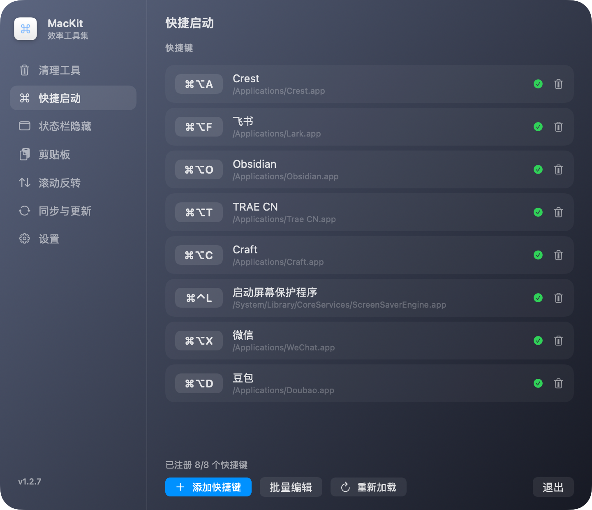
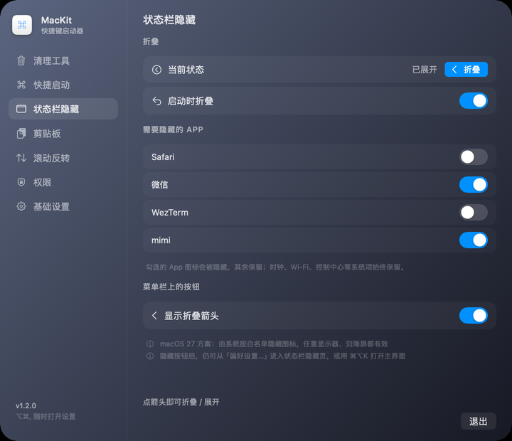
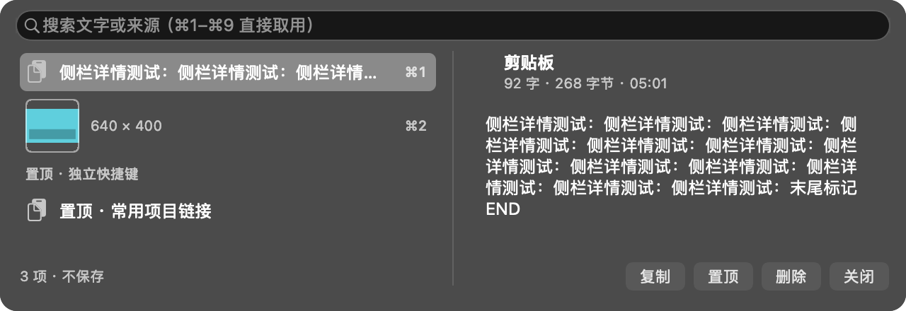
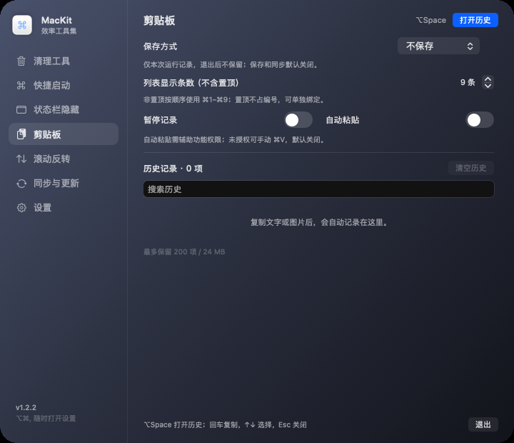
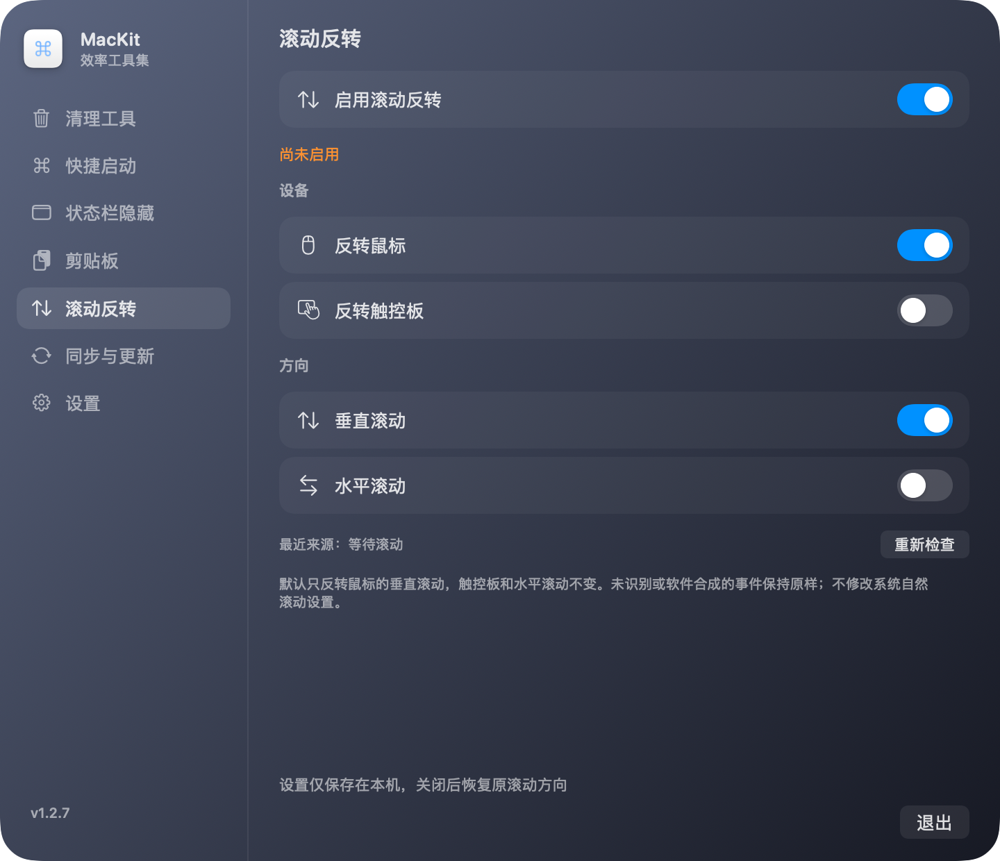
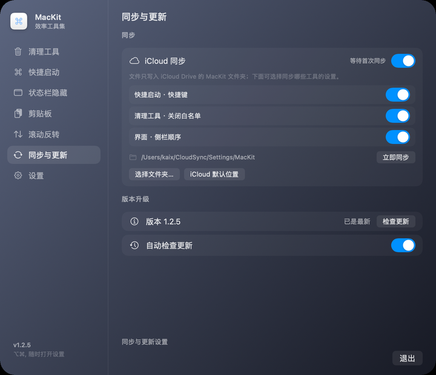
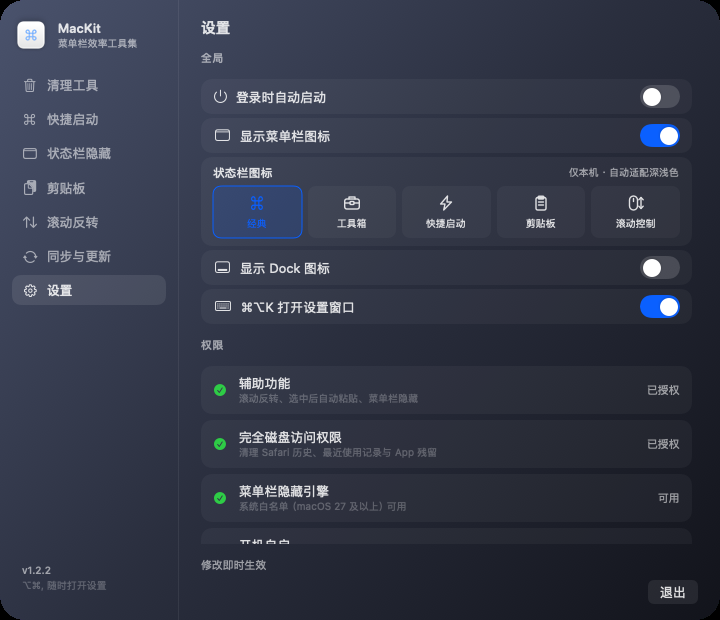

# MacKit

> macOS 菜单栏效率工具：快捷键启动 App、剪贴板历史与图片取字、菜单栏图标整理、系统清理，一个 App 全包。

## 功能一览

| 侧栏 | 一句话 |
|---|---|
| **清理工具** | 按范围清 Safari 历史、最近记录和废纸篓，卸载 App 与残留，一键关闭所有前台 App。 |
| **快捷启动** | 用全局快捷键打开或切换 App，支持 JSON 批量编辑。 |
| **状态栏隐藏** | 把不常用的菜单栏图标按 App 收起，点一下隐藏或展开。 |
| **剪贴板** | ⌥Space 打开历史浮层，支持置顶、编号、图片 OCR 与翻译、本机或 iCloud 保存。 |
| **滚动反转** | 鼠标与触控板分别反转（含水平方向），不改系统「自然滚动」设置。 |
| **同步与更新** | iCloud 同步快捷键 / 白名单 / 侧栏顺序，并检查新版本。 |
| **设置** | 开机自启、菜单栏与 Dock 图标、权限体检、配置与日志入口。 |

## 界面

左侧固定侧栏、右侧内容区，侧栏顺序可拖动调整；窗口可拖拽边角缩放，最小 720×620。

### 清理工具


- 三个开关决定「一键清空记录」的范围：**Safari 浏览记录**（今天 / 今天和昨天 / 一周 / 一个月 / 全部）、**最近使用文件**、**清空废纸篓**。
- 清历史是按 `visit_time` 删除对应记录，不动书签；Safari 正在运行时会先问是否退出。
- 确认弹窗会逐项列出将清理的内容，结果直接显示在页面上。
- **卸载 App 与残留**：按 bundle id 扫描应用本体和 `~/Library` 下的配置、缓存、日志、自启项，逐项勾选后移入废纸篓（可恢复）。
- **批量关闭**：白名单里的 App 保留，Finder 与 MacKit 自身不会被关；使用正常退出请求，未保存内容仍会提示。

### 快捷启动



- 每条快捷键显示按键、目标 App、解析到的真实路径和注册状态。
- 「添加快捷键」选 App 后按下组合键即可生效；「批量编辑」用 JSON 整段改写，⌘S 应用。
- 配置保存在 `~/Library/Application Support/mac-kit/config.json`，`target` 支持应用名、Bundle ID 或完整路径。

### 状态栏隐藏



- 勾选「需要隐藏的 App」，其余保持可见；时钟、Wi-Fi、控制中心等系统项始终保留。
- macOS 27 走系统白名单，任意显示器、刘海屏都有效；更早系统用撑宽分隔条，⌘ 拖动细线划分区域。
- 可选「启动时折叠」；隐藏期间退出 App 会自动解除限制。

### 剪贴板





- ⌥Space 打开浮层：搜索、↑↓ 选择、回车复制、Esc 关闭；普通候选对应 ⌘1–⌘9，置顶项独立分组。
- 任意一条都能绑定全局快捷键；支持暂停记录、选中后自动粘贴（需辅助功能）。
- 图片右键可选「提取文字（OCR）」或「提取文字并翻译」：Vision 本地识别，翻译用 Apple 翻译框架，首次会引导下载语言包。
- 保存方式三选一：不保存（仅本次运行）/ 本机 / iCloud 文件夹；上限 200 条、24 MB。

### 滚动反转



- 鼠标与触控板分别开关，垂直与水平分别开关；默认只反转鼠标垂直滚动。
- 通过 Quartz 拦截滚动事件，不修改系统设置；关闭功能或退出 App 即恢复原方向。
- 检测到 Scroll Reverser 正在运行会自动暂停，避免双重处理。

### 同步与更新



- 数据写到 iCloud Drive 的 `MacKit/settings.json`，也可指定任意文件夹；写入用临时文件 + 原子替换。
- 同步内容按工具单独开关：**快捷键**、**关闭白名单**、**侧栏顺序**；菜单栏 / Dock 图标等本机偏好不参与。
- 合并按 `updatedAt` 判断，远端明显更新才覆盖，两端最终收敛。
- 版本升级：启动后查一次，之后每 6 小时；发现新版本给出下载入口，不做静默替换。

### 设置



- 开机自启（LaunchAgent）、显示菜单栏图标 / Dock 图标、五款状态栏图标、⌘⌥K 打开设置。
- **权限体检**：辅助功能、完全磁盘访问、隐藏引擎、开机自启的状态一目了然，未授权可直接跳转系统设置。
- **配置与日志**：重新加载配置、打开配置文件、打开日志。

## 入口与快捷键

| 操作 | 方式 |
|---|---|
| 打开设置 | 菜单栏图标 → 偏好设置…，或 ⌘⌥K，或直接打开 App |
| 剪贴板历史 | ⌥Space |
| 兜底打开设置 | ⌥⌘,（不受任何开关影响） |
| 关闭窗口 | ⌘W |

- 手动打开 App 会直接弹出设置窗口；登录自启时只驻留菜单栏。
- 侧栏七项的顺序可上下拖动，会记在本机并随同步开关一起同步。

## 安装

要求 Apple 芯片、macOS 13 或更高。

下载 `MacKit-<版本>.zip`，解压后把 `MacKit.app` 拖进 `/Applications`。首次打开若提示「未验证的开发者」，右键 → 打开，不需要关闭系统安全保护。

## 权限

| 权限 | 用在哪 | 未授权时 |
|---|---|---|
| 辅助功能 | 滚动反转、选中后自动粘贴 | 两个功能无法启用 |
| 完全磁盘访问 | 清理 Safari 历史 / 最近记录、卸载残留 | 相关清理会提示无权限 |

授权后需要退出并重启 MacKit。「设置 → 权限」会显示当前状态，并可直接跳到对应系统设置页。

## 命令行

```bash
APP=/Applications/MacKit.app/Contents/MacOS/MacKit

$APP --check              # 检查快捷键能否注册、目标能否解析
$APP --version            # 当前版本
$APP --update-check       # 立刻检查更新
$APP --scan-residue mimi  # 只读预览某个 App 的残留
$APP --ocr-test shot.png  # 只做图片文字识别
$APP --snapshot out.png --page tools   # 离屏渲染界面截图
```

## 数据与卸载

| 内容 | 位置 |
|---|---|
| 快捷键配置 | `~/Library/Application Support/mac-kit/config.json` |
| 剪贴板历史 | `~/Library/Application Support/mac-kit/clipboard/history.json` |
| 同步文件 | `<iCloud Drive>/MacKit/settings.json` |
| 日志 | `~/Library/Logs/mac-kit.log` |
| 开机自启 | `~/Library/LaunchAgents/com.kaix.mac-kit.plist` |

卸载时先退出 App，删除 `/Applications/MacKit.app` 和上表里的文件即可；「设置 → 权限」里授予的权限记得一并取消。

## 构建

```bash
./build.sh          # 构建并安装到 /Applications
./build.sh none     # 只构建到 build/
```

构建优先使用钥匙串里名为 `MacKit Local Signing` 的证书签名；找不到时退回 ad-hoc——那时系统权限会在每次重建后失效，需要重新授权。
